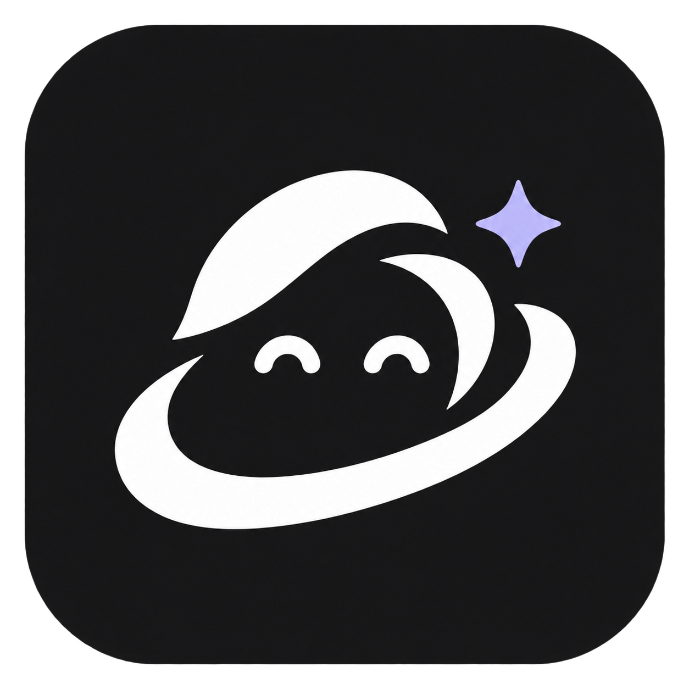
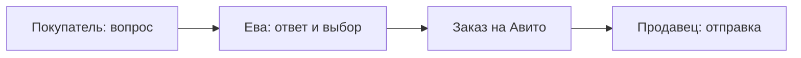
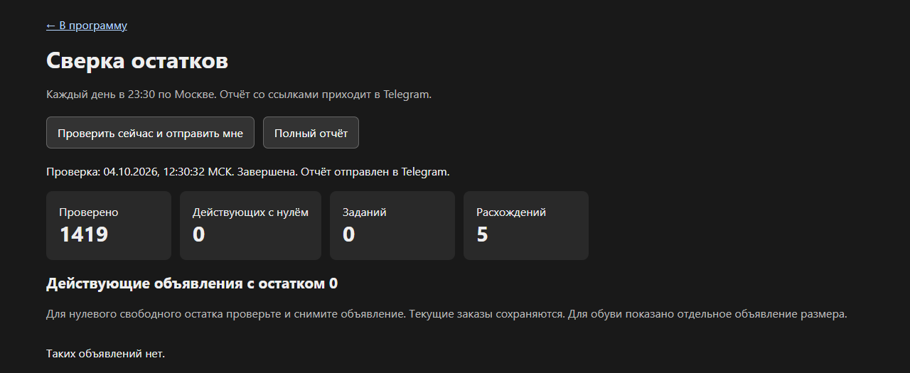
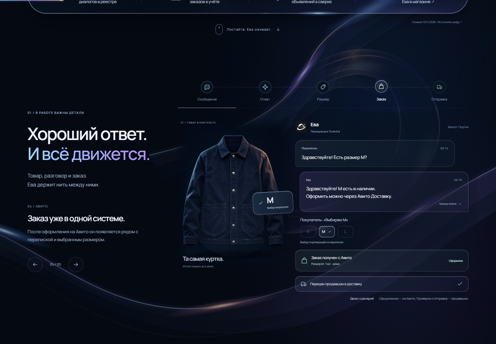

  

<h1 align="center">Toventra — больше внимания покупателям. Меньше рутины продавцу.</h1>

Программа для магазина на Авито. Ева внутри помогает с перепиской, товарами, размерами, фотографиями и учётом заказов.

<a href="overview.md">Знакомство</a> · <a href="how-eva-works.md">Как работает</a> · <a href="architecture.md">Устройство</a> · <a href="faq.md">Частые вопросы</a>

## Что такое Toventra

**Toventra — название программы. Ева — помощница внутри неё.** Программа объединяет работу магазина, а Ева помогает покупателям и связывает разговор с товарами и заказами.

У покупателя три вопроса, у продавца десятки диалогов, а нужный размер спрятан между карточкой товара и перепиской. Ева помогает собрать это в один понятный процесс: прочитать контекст, найти сведения, ответить и связать разговор с заказом.

Она уже используется в рабочем проекте магазина. Это не только генератор текста: система хранит выбор покупателя, проверяет разрешённые действия и различает «ответ подготовлен» и «ответ действительно доставлен».

> [!IMPORTANT]
> Покупатель сам оформляет и оплачивает заказ на Авито. Продавец физически проверяет, собирает и передаёт посылку. Ева помогает с информацией, перепиской и учётом.

## Что она умеет

| Возможность | Что это даёт |
| --- | --- |
| Отвечать покупателям | Учитывать историю, товар и правила магазина, а не только последнюю фразу |
| Разбирать несколько вопросов | Отдельно ответить о наличии, размере, составе или оформлении |
| Работать с размерами | Различать маркировку, таблицу, реальный замер и подтверждённый выбор |
| Отправлять разрешённые оригиналы фото | Помнить просьбу и проверять доставку каждого изображения |
| Вести учёт заказов | Показывать согласованный размер, распределение товара и этапы заказа |
| Следить за остатками | Учитывать заказы и резервы, показывать расхождения и неизвестные значения |
| Искать другие товары | Подбирать варианты из каталога и давать подтверждённые ссылки |
| Работать в фоне | Обрабатывать обращения и синхронизации, пока программа и подключения доступны |

Подробнее: [диалоги](conversations.md), [фото](photos.md), [заказы](orders.md), [защита действий](safety.md).

## Что уже подтверждено

Снимки рабочего проекта **12 ноября 2026**, время — московское:

| Показатель | Значение | Что именно посчитано |
| --- | ---: | --- |
| Диалоги в реестре | **6 727** | Записи реестра на 01:01:20; не число отвеченных или закрытых обращений |
| Заказы в учёте | **1 205** | Все учтённые статусы на 01:22:02; не продажи, созданные Евой |
| Объявления в снимке сверки | **1 937** | Объём снимка на 01:34:54; проверка остатков неполная |

> [!NOTE]
> Эти цифры показывают масштаб учёта. Они не доказывают прирост продаж, выручку или скорость ответа. У 74 неактивных объявлений Quantity неизвестен. [Методика и ограничения →](metrics.md)

## Как это выглядит

*Настоящий интерфейс, архив 04.10.2026. Опубликована только область без внутренних идентификаторов. Старые числа на снимке не являются текущими метриками.*

Посмотреть учебную сцену диалога и заказа

*Демонстрационная сцена сайта Toventra, не снимок production-интерфейса. Изображение куртки сгенерировано для примера; товар, переписка, размер и время вымышлены. Этапы показывают подтверждённые возможности.*

## Куда читать дальше

| Хочу понять | Страница |
| --- | --- |
| Подойдёт ли мне Ева | [Обзор](overview.md) · [FAQ](faq.md) |
| Как вопрос превращается в результат | [Полный процесс](how-eva-works.md) · [Диалоги](conversations.md) |
| Откуда берутся ответы | [Знания о товаре](product-knowledge.md) · [Размеры и замеры](sizes-and-measurements.md) |
| Как работают фото, заказы и поиск | [Фото](photos.md) · [Заказы](orders.md) · [Поиск](catalogue-search.md) |
| Что происходит при ошибках | [Надёжность](reliability.md) · [Безопасность](safety.md) |
| Как устроена система | [Архитектура](architecture.md) · [Инфраструктура](infrastructure.md) |
| На чём основаны утверждения | [Метрики](metrics.md) · [Источники](sources.md) · [История развития](changelog.md) |

Этот репозиторий содержит **только документацию, проверенные изображения и обезличенные агрегаты**. Здесь нет production-кода, рабочей базы, секретов и переписки покупателей. Это не установочный пакет и не готовое публичное подключение сервиса.

[Правила обновления](CONTRIBUTING.md) · [Проверка приватности](privacy-review.md) · [Описание изображений](assets/screenshots/README.md)

---

Назад: начало · [Содержание](README.md) · [Далее: знакомство →](overview.md)
