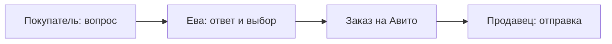

  

<h1 align="center">Toventra — больше внимания покупателям. Меньше рутины продавцу.</h1>

Программа для магазина на Авито. Ева внутри помогает с перепиской, товарами, размерами, фотографиями и учётом заказов.

<a href="overview.md">Знакомство</a> · <a href="results.md">Результаты</a> · <a href="telegram-intake.md">Приёмка в Telegram</a> · <a href="architecture.md">Устройство</a> · <a href="faq.md">Частые вопросы</a>

## Что такое Toventra

**Toventra — название программы. Ева — помощница внутри неё.** Программа объединяет работу магазина, а Ева помогает покупателям и связывает разговор с товарами и заказами.

У покупателя три вопроса, у продавца десятки диалогов, а нужный размер спрятан между карточкой товара и перепиской. Ева помогает собрать это в один понятный процесс: прочитать контекст, найти сведения, ответить и связать разговор с заказом.

Она уже используется в рабочем проекте магазина. Это не только генератор текста: система хранит выбор покупателя, проверяет разрешённые действия и различает «ответ подготовлен» и «ответ действительно доставлен».

> [!IMPORTANT]
> Покупатель сам оформляет и оплачивает заказ на Авито. Продавец физически проверяет, собирает и передаёт посылку. Ева помогает с информацией, перепиской и учётом.

## Что она умеет

| Возможность | Что это даёт |
| --- | --- |
| Отвечать покупателям | Учитывать историю, товар и правила магазина, а не только последнюю фразу |
| Разбирать несколько вопросов | Отдельно ответить о наличии, размере, составе или оформлении |
| Работать с размерами | Различать маркировку, таблицу, реальный замер и подтверждённый выбор |
| Отправлять разрешённые оригиналы фото | Помнить просьбу и проверять доставку каждого изображения |
| Вести учёт заказов | Показывать согласованный размер, распределение товара и этапы заказа |
| Следить за остатками | Учитывать заказы и резервы, показывать расхождения и неизвестные значения |
| Искать другие товары | Подбирать варианты из каталога и давать подтверждённые ссылки |
| Работать в фоне | Обрабатывать обращения и синхронизации, пока программа и подключения доступны |
| Принимать товар через Telegram | Собирать фото, текст/голос, варианты, количество и место хранения; переносить в Toventra |

Подробнее: [диалоги](conversations.md), [фото](photos.md), [заказы](orders.md), [защита действий](safety.md).

## Что уже подтверждено

За **2 ноября, 00:00 — 12 ноября 2026, 04:55 МСК**:

| Показатель | Значение | Что именно посчитано |
| --- | ---: | --- |
| Диалоги с доставленным ответом Евы | **546** | Как минимум один точный подтверждённый ответ в каждом |
| Текстовые ответы Евы | **840** | Подтверждены попыткой и точным сообщением в истории |
| Ночные ответы | **121** | В 97 диалогах с 00:00 до 05:59 МСК |
| Отправленные изображения | **22** | Подтверждены в 5 диалогах |

> [!NOTE]
> Подтверждённый ответ не означает решения всех вопросов. Заказы магазина не приписаны Еве целиком; процент роста продаж отдельно не измерен. [Результаты и время ответа](results.md) · [Методика](metrics.md)

## Магазин: товар, закупка и оборот

| Показатель | Значение | Дата или период |
| --- | ---: | --- |
| Различные связанные товарные артикулы | **1 075** | Срез каталога 12.11.2026 |
| Объявления в сверке | **1 937** | 12.11.2026, действующие и неактивные вместе |
| Учётное количество товара, архив | **2 950 шт.** | Архив 12.10.2026; не сегодняшняя физическая инвентаризация |
| Записанные оплаченные закупки | **153 000 ₽** | 25.09–24.10.2026 включительно |
| Заказы магазина | **266** | 02.11, 00:00 — 12.11.2026, 04:55 МСК |
| Оборот по сумме заказов | **173 665 ₽** | Тот же ноябрьский период, все текущие статусы |

Срезы имеют разные даты. Артикулы и объявления не равны физическим штукам; у 470 строк каталога сопоставление с товаром отсутствует. Текущий физический остаток отдельно не подтверждён. Оборот здесь — сумма оформленных заказов, а не поступившие деньги или чистая прибыль.

Полная расшифровка, неполная оценка закупочной стоимости склада и обезличенные источники: **[«Товар, закупка и оборот» →](business-statistics.md)**.

## Чему научилась Ева

| Этап | Что появилось в системе |
| --- | --- |
| Сентябрь 2026 | Связанный контекст диалога и заказа, согласованный размер, оригинальные фото и сведения приёмки |
| 2–8 ноября | Долговременное состояние в PostgreSQL, обработка отдельных вопросов и фоновая проверка старой истории |
| 12 ноября | Уточнён учёт Стоп и общего остатка, возврата до личной приёмки, места поставки и подтверждения сборки |

«Научилась» означает добавленные и проверенные механизмы, правила и источники знаний. Самостоятельное дообучение модели на каждом покупателе не заявлено. **[Развитие Евы →](eva-development.md)**.

## Как она помогает продажам

Ева отвечает на вопросы, показывает товар и помогает согласовать вариант, в том числе ночью. За измеренный период подтверждены 121 ночной ответ и 22 изображения; покупатель может получить сведения до следующего рабочего дня продавца.

**Подтверждённого процента роста продаж пока нет.** Заказы магазина, работа Евы и причинный эффект разделены. Что уже измерено и как корректно оценить прирост — **[в разделе о влиянии на продажи](sales-impact.md)**.

## С телефона — в общий магазин

В Telegram продавец выбирает поставку и место приёмки, отправляет фото, текст или голос, указывает размеры, количество и где лежит вещь. После сохранения очередь переносит карточку в Toventra. Временный обрыв не означает потерю уже сохранённого товара.

Фото полки остаются внутренними. Сохранение приёмки не публикует объявление само по себе. [Четыре шага приёмки](telegram-intake.md) · [Telegram как рабочий пульт](telegram-workspace.md) · [Склад и возвраты](warehouse-and-returns.md)

## Как это выглядит

*Настоящий интерфейс, архив 04.10.2026. Опубликована только область без внутренних идентификаторов. Старые числа на снимке не являются текущими метриками.*

Посмотреть учебную сцену диалога и заказа

*Демонстрационная сцена сайта Toventra, не снимок production-интерфейса. Изображение куртки сгенерировано для примера; товар, переписка, размер и время вымышлены. Этапы показывают подтверждённые возможности.*

## Куда читать дальше

| Хочу понять | Страница |
| --- | --- |
| Подойдёт ли мне Ева | [Обзор](overview.md) · [FAQ](faq.md) |
| Что она уже сделала | [Результаты](results.md) · [Товар, закупка и оборот](business-statistics.md) |
| Как помогает продажам и чему научилась | [Влияние на продажи](sales-impact.md) · [Развитие Евы](eva-development.md) |
| Как принимать товар с телефона | [Приёмка в Telegram](telegram-intake.md) · [Рабочий пульт](telegram-workspace.md) |
| Как не перепутать свободное, заказанное и возврат | [Склад и возвраты](warehouse-and-returns.md) |
| Как вопрос превращается в результат | [Полный процесс](how-eva-works.md) · [Диалоги](conversations.md) |
| Откуда берутся ответы | [Знания о товаре](product-knowledge.md) · [Размеры и замеры](sizes-and-measurements.md) |
| Как работают фото, заказы и поиск | [Фото](photos.md) · [Заказы](orders.md) · [Поиск](catalogue-search.md) |
| Что происходит при ошибках | [Надёжность](reliability.md) · [Безопасность](safety.md) |
| Как устроена система | [Архитектура](architecture.md) · [Инфраструктура](infrastructure.md) |
| На чём основаны утверждения | [Метрики](metrics.md) · [Источники](sources.md) · [История развития](changelog.md) |

Этот репозиторий содержит **только документацию, проверенные изображения и обезличенные агрегаты**. Здесь нет production-кода, рабочей базы, секретов и переписки покупателей. Это не установочный пакет и не готовое публичное подключение сервиса.

[Правила обновления](CONTRIBUTING.md) · [Проверка приватности](privacy-review.md) · [Описание изображений](assets/screenshots/README.md)

---

Назад: начало · [Содержание](README.md) · [Далее: знакомство →](overview.md)
