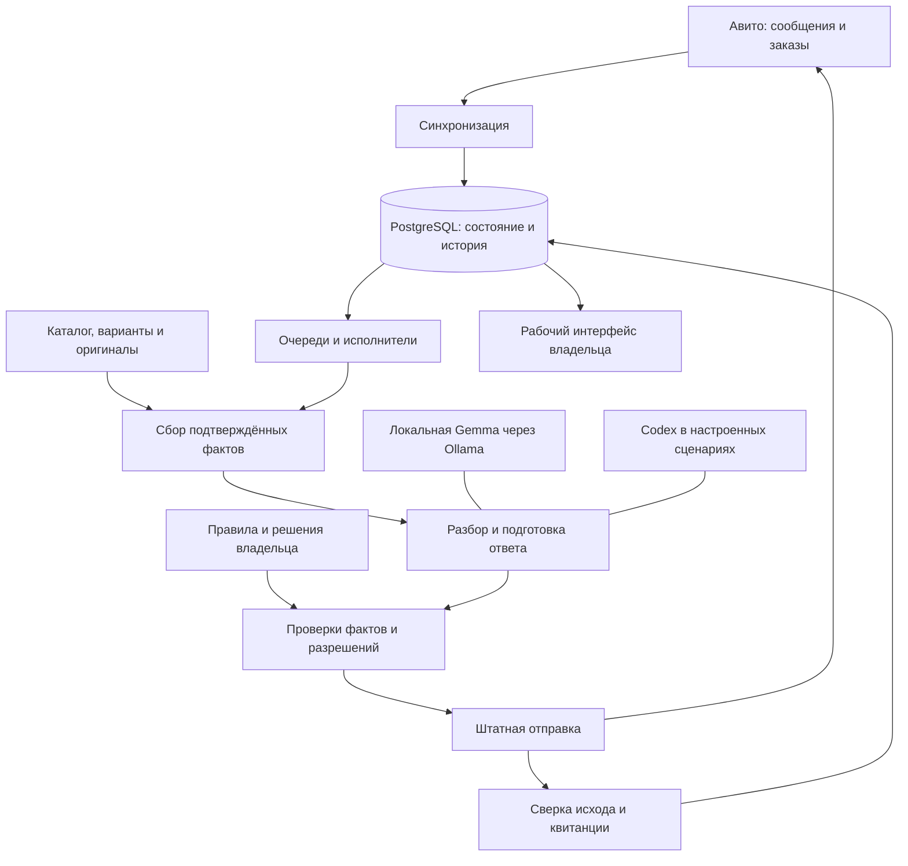

# Архитектура человеческим языком

У Евы есть несколько частей, каждая со своей работой. Одна получает сообщения, другая собирает факты, модель помогает понять вопрос и написать ответ, а отдельные проверки решают, можно ли выполнить действие.

Модель не заменяет базу товаров, правила владельца и подтверждение доставки.

Схема показывает роли, а не список запущенных процессов или точную сетевую топологию.

## Компоненты и роли

| Компонент | Простое объяснение | Техническая роль |
| --- | --- | --- |
| Синхронизация | Приносит новые события | Чтение сообщений, заказов и состояний площадки |
| PostgreSQL | Долговременная память | История, очередь, попытки, выбор, учёт и охват проверок |
| Очередь | Помнит, что ещё нужно сделать | Сохранённые заявки на работу, приоритеты, защита от повторной обработки |
| Worker | Выполняет конкретную работу | Разбор обращения и ограниченные этапы обработки |
| Модель | Помогает понимать и формулировать | Локальный модельный путь и настроенные сценарии Codex |
| Проверки | Сопоставляют слова с фактами | Товар, наличие, согласие, актуальность и разрешение действия |
| Транспорт | Отправляет разрешённое | Единственный штатный путь внешнего действия и его попыток |
| Watchdog | Ищет зависшую работу | Сверка реальной активности, попыток и незавершённых задач |
| Интерфейс | Показывает состояние человеку | Диалоги, заказы, сведения о товаре, склад и предупреждения |

## Почему фоновые задачи разделены

Ответ на свежий вопрос не должен ждать перечитывания тысяч старых историй. Поэтому очередь новых обращений, проверка старой истории, синхронизация заказов и ежедневная сверка остатков выполняют разные задачи.

Для глубокой истории сохраняется **охват** — какие известные диалоги успешно проверены, когда и с какими ошибками. Неизвестные старые диалоги за пределами индекса API не объявляются проверенными.

Ежедневная сверка использует общий слот запуска: два планировщика не должны запускать два одинаковых полных обхода.

## Где проходит граница доверия

Модель предлагает текст и действия. Решение об отправке требует свежего состояния и штатных проверок. Даже хороший ответ, подготовленный по старой версии чата, может быть уже неуместен после нового сообщения или ручного подключения владельца.

Основные данные хранятся в PostgreSQL. Наличие совместимого слоя со старым интерфейсом хранилища не означает, что старая SQLite-база остаётся актуальным рабочим источником.

**Подтверждение:** исходники фоновых планировщиков, очереди, состояния runtime, модельного пути и актуальные правила PostgreSQL. [Карта источников](sources.md).

---

[← Назад: процесс](how-eva-works.md) · [Содержание](README.md) · [Далее: диалоги →](conversations.md)
