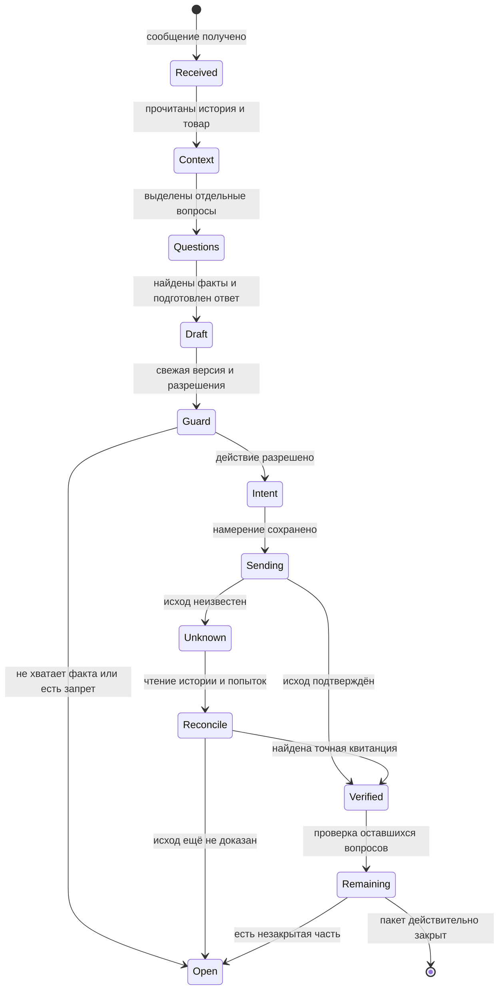

# Как Ева ведёт диалог

Ева должна понять не только слова, но и то, к чему они относятся. «Да», «тот размер» или «Фото» имеют смысл только вместе с предыдущим разговором.

## Контекст без смешения покупателей

Связь строится по устойчивым идентификаторам площадки, а не имени человека. Связанные чаты одного покупателя читаются с учётом конкретного товара; вопрос о другой вещи не переносит на неё цену, наличие и заказ текущего объявления.

Полная релевантная история важнее одного последнего сообщения. При этом старая нерешённая отправка другого чата не должна автоматически закрывать новый независимый вопрос: связь и независимость нужно доказать отдельно.

## Несколько вопросов — несколько результатов

Учебный пример:

> **Покупатель:** «Есть M? Какой состав? Можно фото?»
>
> **Ответ текстом:** сообщает подтверждённое наличие и известный состав.
>
> **Оставшаяся задача:** отправить разрешённые фото и проверить квитанции.

Последнее исходящее сообщение не доказывает, что отвечено на всё. Отдельно учитываются размер, наличие, замеры, состав, комплектация, оформление, возврат и фото.

| Ситуация | Как её следует понимать |
| --- | --- |
| «???» или повторная просьба | Перечитать предыдущий вопрос и фактический исход |
| «Спасибо» после полного решения | Обычно не продолжать разговор без нового вопроса |
| «Если M — это нужный размер» | Условие, а не окончательный выбор |
| «Нет, всё-таки беру L» | Более позднее явное изменение выбора |
| «Выполняется» на старой карточке | Проверить реального исполнителя и свежую активность |

## Жизненный цикл сообщения

Здесь `Open` — сохранённая незавершённая задача. Это не успешный ответ и не разрешение обойти запрет.

## Ручное подключение

Открытие чата само по себе не забирает управление. При явном ручном подключении меняются ответственный и версия состояния; ручное удержание сохраняется. Старый worker не должен отправить ответ поверх нового решения владельца.

По правилам проекта ответы обычно короткие: по существу каждого вопроса, без пересказа всей истории и повторения уже доставленных оговорок.

**Подтверждение:** рабочее пространство диалогов, очередь и актуальные правила разбора пакетов. [Источники](sources.md).

---

[← Назад: архитектура](architecture.md) · [Содержание](README.md) · [Далее: знания о товаре →](product-knowledge.md)
