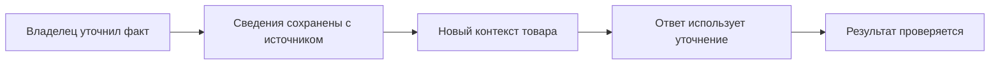

# Чему научилась Ева и как она развивается

«Научилась» здесь означает **в систему добавили и проверили новый способ работы**: правила, источники знаний, обработку ситуации или защиту действия. Это не утверждение, что модель сама дообучается на каждом покупателе.

## От короткого ответа к связанному процессу

| Направление | Что умеет система | Что это меняет |
| --- | --- | --- |
| Контекст | Читает связанную историю и текущий пакет сообщений | «А фото?» рассматривается вместе с исходной просьбой |
| Несколько вопросов | Учитывает каждую тему отдельно | Ответ о наличии не закрывает вопрос о ткани или размере |
| Источники фактов | Отличает слова владельца, приёмку, таблицу, замер и оценку | Неизвестные сантиметры не появляются из догадки по фото |
| Размер | Хранит подтверждённый выбор отдельно от оплаченной строки | Расхождение видно до неподтверждённой комплектации |
| Фото | Помнит просьбу и проверяет исход каждой отправки | Подготовленное фото не считается доставленным автоматически |
| Поиск | Ищет другие товары по каталогу и проверяет ссылки | Похожесть не подменяет реальное наличие |
| Заказы и остатки | Связывает разговор с заказом и обязательствами склада | Стоп и отсутствие размера не освобождают проданный товар |
| Восстановление | Сохраняет очередь, попытки и неизвестный исход | После сбоя можно продолжить проверку без слепого повтора |

## Подтверждённые этапы

| Время | Развитие |
| --- | --- |
| Сентябрь 2026 | Рабочее пространство диалогов и заказов; согласованный размер; оригинальные фото; приёмка и места хранения |
| 2 ноября | PostgreSQL как основной источник рабочего пространства; уточнение источников знаний |
| 3–5 ноября | Короткие полезные ответы по отдельным вопросам; аккуратное применение размерных ориентиров |
| 7–8 ноября | Разделение быстрой сверки и фоновой истории; повторная проверка старых открытых вопросов |
| 12 ноября | Уточнены общий пул остатка, возврат до личной приёмки, место новой поставки и различие печати/сборки |

Точные основания и более подробные даты — в [истории изменений](changelog.md). Добавленный механизм не означает, что каждое историческое обращение уже обработано без ошибки.

## Как исправление становится знанием

Например, если владелец подтвердил ткань в приёмке конкретной вещи, это может стать источником для следующего ответа. Сгенерированное описание или похожая фотография таким подтверждением не являются.

## Она сама меняет свои правила?

Нет основания обещать неограниченное самостоятельное обучение. Владелец задаёт факты и разрешения; инженерные изменения проходят проверку. История разговора помогает учитывать продолжение, но не даёт права менять склад, цену или физическую комплектацию без соответствующего разрешения.

---

[← Назад: влияние на продажи](sales-impact.md) · [Содержание](README.md) · [Далее: Telegram и приёмка →](telegram-intake.md)
