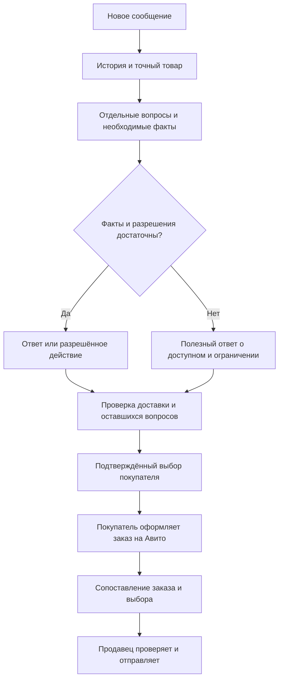

# От сообщения до результата

До нового сообщения товар проходит [приёмку через Telegram](telegram-intake.md): фото, текст или голос, размеры, количество и место. Сохранённые сведения переносятся в Toventra; они не становятся автоматически опубликованным объявлением.

Представим обычный вопрос: «Здравствуйте! Есть M? И можно реальные фото?» Это **учебный пример**, не переписка покупателя из рабочего магазина.

## 1. Получить обращение

Штатная синхронизация получает сообщение. Ева связывает его с точным диалогом и товаром и читает предыдущий контекст. Два одинаковых имени не означают одного покупателя.

## 2. Разделить задачи

В примере две задачи: ответить о размере M и отправить фото. Доставленный текст о наличии закрывает только первую. Вторая остаётся открытой до подтверждённой отправки изображений либо честного объяснения ограничения.

## 3. Найти сведения и проверить условия

Ева проверяет данные товара, текущий свободный вариант и разрешённые оригиналы. Если известна только размерная таблица, она не выдаёт её за физический обмер вещи.

## 4. Подготовить и доставить ответ

Текст проходит проверки фактов и разрешений. Перед внешним действием сохраняется его намерение: что именно собираемся сделать. После отправки проверяется результат площадки и история.

Если результат неизвестен, новое одинаковое сообщение не отправляется вслепую.

## 5. Сохранить выбор и получить заказ

«Выбираю M» может быть подтверждением выбора. «Если M подойдёт» — ещё условие. Покупатель оформляет заказ на Авито; Ева получает его в учёт и сопоставляет с разговором.

## 6. Проверить и передать товар

Продавец проверяет реальную вещь и комплектацию. Несовпадение размера не исчезает от оплаты или слова «спасибо». После фактической передачи меняется статус доставки.

## Что считается результатом

Результат — доставленный полезный ответ, подтверждённое действие или явно сохранённый открытый вопрос с причиной и следующим шагом. Метка «Выполняется», готовый черновик и неизменившийся счётчик сами по себе результатом не являются.

**Дальше для разработчика:** [жизненный цикл сообщения](conversations.md), [контроль отправки](reliability.md), [границы полномочий](safety.md).

---

[← Назад: обзор](overview.md) · [Содержание](README.md) · [Далее: архитектура →](architecture.md)
