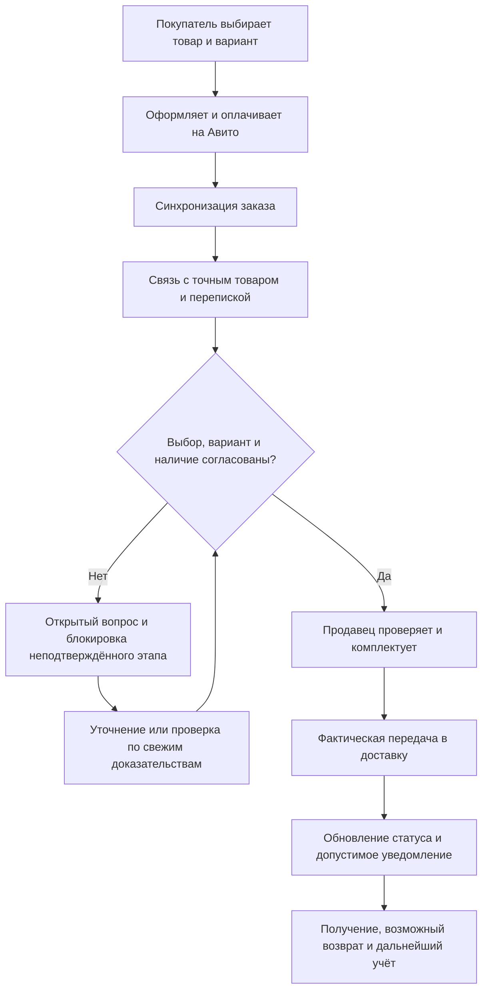

# Заказы, резервы и отправка

Заказ оформляет покупатель на Авито. Ева получает его в учёт, связывает с перепиской и помогает увидеть, что выбрано, что занято и что ещё требует решения.

## Не смешивать пять сущностей

| Сущность | Что означает |
| --- | --- |
| Выбор покупателя | Явное согласие на конкретную вещь и вариант |
| Оплаченная строка | Что записано в заказе площадки |
| Резерв | Учётное удержание в пределах действующего разрешения и срока |
| Распределение | Какая часть остатка назначена позиции заказа |
| Физическая комплектация | Что продавец действительно проверил и положил в посылку |

Одна сущность не доказывает другую. Резерв не равен оплате, а ручной размер в форме не заменяет согласия человека.

Схема иллюстрирует обычный сценарий. Оплата без согласованного размера тоже возможна — тогда проверка не пропускается.

## Размер и изменение решения

Система сопоставляет заказанный и согласованный варианты. Учитывается более поздний реальный выбор, в том числе после отказа от другой замены. Старая общая карточка объявления и одно слово «спасибо» не считаются достаточным подтверждением.

При расхождении сохраняется предупреждение. Физическая проверка и её актуальность относятся к версии заказа; новый факт может потребовать новой сверки.

## Что происходит с остатком

Свободное количество учитывает заказы и резервы. Нераспределённый заказ может удерживать общий остаток, даже если конкретный размер ещё не выбран. Превышение резервов тоже нельзя игнорировать. Размеры обуви учитываются раздельно.

Остановка сборки не освобождает оплаченный товар. Отмена до передачи может освобождать удержание в соответствии с состоянием заказа. Отправленный возврат не становится доступным до физической проверки.

## Уведомления и повторы

Уведомление привязывается к реальному событию заказа. Подтверждённое сообщение не должно повторяться из-за нового опроса API или перестановки позиций в ответе.

Если исход отправки неизвестен, сначала сверяется прежняя попытка. Общая пауза, индивидуальные запреты, ручное управление и остальные разрешения сохраняются.

> [!IMPORTANT]
> Ева не оформляет и не отменяет заказ за покупателя. Резервы и временные скидки не являются неограниченным правом модели: нужны действующие разрешения и штатные проверки. [Таблица полномочий](safety.md).

**Подтверждение:** согласование размера, панель заказа, стабильное сопоставление позиций, уведомления и актуальные правила учёта.

---

[← Назад: фотографии](photos.md) · [Содержание](README.md) · [Далее: поиск →](catalogue-search.md)
