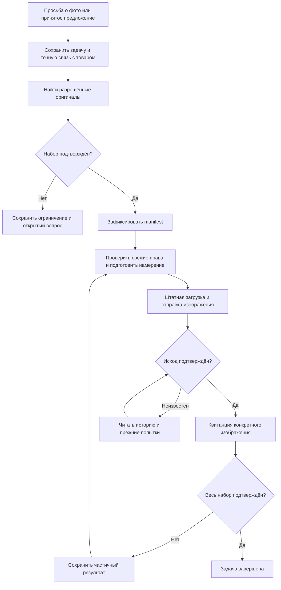

# Реальные фотографии: от просьбы до доставки

«Фото отправлены» должно означать, что изображения действительно появились в нужном диалоге. Текст с обещанием или успешная загрузка файла ещё не доказывают доставку покупателю.

## Что такое photo obligation

Это сохранённая **незавершённая задача по просьбе о фото**. Техническое название — *photo obligation*. Она связывает запрос с точным разговором, входящим сообщением, товаром и разрешённым действием.

Задача переживает переходы текста и восстановление обработки. Ответ о цене или размере не закрывает её. Короткое продолжение «Фото» требует прочитать предыдущую просьбу, а не признать сообщение пустым.

## Что такое manifest

Manifest — зафиксированный список конкретных изображений для этой отправки. Он нужен, чтобы при частичном результате не подменить набор другим товаром и не отправить заново уже доставленное.

В проекте проверяются исходный товар и объявление, происхождение и разрешённость оригиналов, отпечаток списка и неизменность подготовленного набора. При частичной отправке прежний manifest не перестраивается незаметно.

Петля проверки неизвестного исхода означает повторное чтение, **не новую отправку**. Подтверждённые изображения повторно не отправляются; продолжение относится только к оставшимся допустимым действиям. При неустранённой неопределённости задача остаётся открытой. Исчерпание ограниченных попыток показывает техническую проблему, а не успешное выполнение.

## Что такое receipt

Receipt — квитанция результата. Для фото недостаточно идентификатора загруженного файла: нужен подтверждённый исход сообщения с изображением. Проект сопоставляет попытки, изображения и фактические сообщения нужного чата.

| Состояние | Что можно утверждать |
| --- | --- |
| Запрос получен / поиск | Просьба сохранена, доставка ещё не доказана |
| Manifest готов / подготовка | Набор определён, отправка ещё не завершена |
| Часть подтверждена | Доставлены только подтверждённые изображения |
| Неизвестный исход | Требуется сверка, повтор вслепую запрещён |
| Всё подтверждено | Фото-набор действительно завершён |
| Техническая проблема | Требуется разбор причины; просьба не считается исполненной |

## Какие изображения допускаются

Разрешённые оригиналы точного товара. Генерированные, обработанные и внутренние складские кадры не подменяют запрос на реальные фото. Если нужного оригинала нет, это ограничение нельзя скрыть похожей картинкой.

Ручной выбор фото использует тот же штатный контроль товара, владельца чата, запретов и результата. «Сверить отправку» проверяет прежнюю попытку, а не создаёт новую.

**Подтверждение:** модуль photo obligation, обработка оригиналов, manifest и проверенный транспорт. [Источники](sources.md).

---

[← Назад: размеры](sizes-and-measurements.md) · [Содержание](README.md) · [Далее: заказы →](orders.md)
