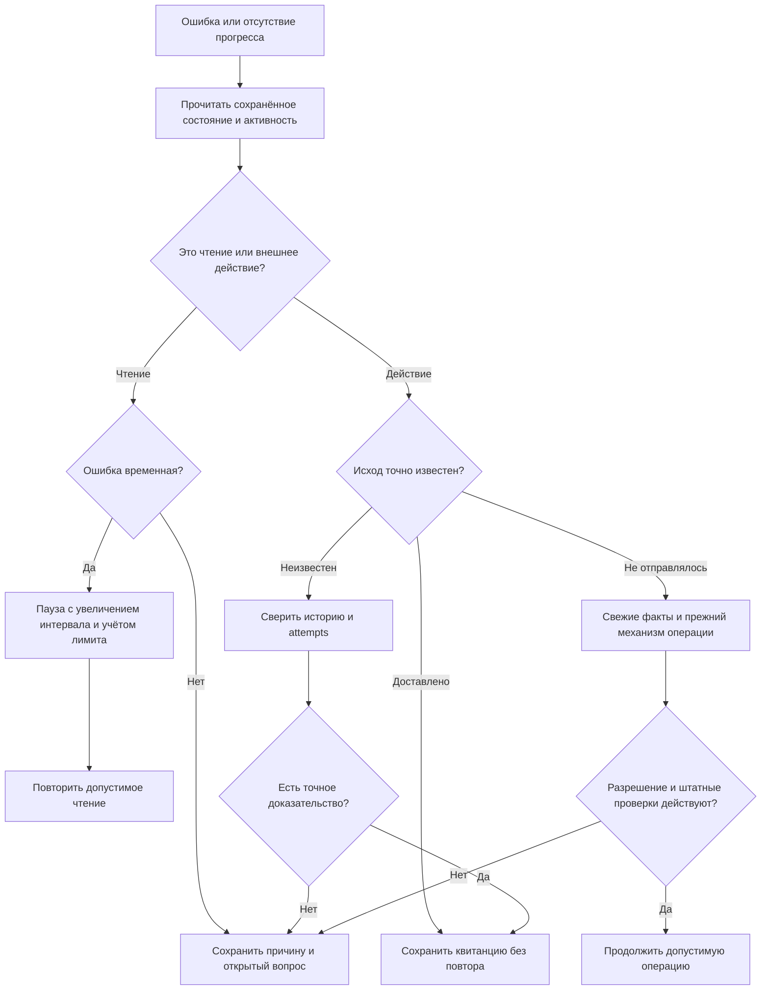

# Что происходит при ошибках

Надёжность — это не обещание «ошибок не бывает». Это способность отличить временную проблему от запрета, сохранить незавершённую работу и не сделать действие дважды.

## Пять полезных слов

| Термин | Простыми словами |
| --- | --- |
| Retry | Ограниченная повторная попытка после понятной временной ошибки |
| Recovery | Восстановление незавершённой работы по сохранённому состоянию |
| Watchdog | Наблюдатель, который ищет отсутствие реального прогресса |
| Idempotency | Одинаковая операция с тем же ключом не создаёт второй эффект |
| Checkpoint | Сохранённая точка, от которой можно безопасно продолжить |

## Повтор чтения и повтор действия различаются

Ещё раз прочитать историю обычно безопаснее, чем ещё раз отправить сообщение, фото или изменение цены. Если площадка могла принять действие, но ответ потерялся, результат считается **неизвестным**.

Новый ключ запроса не делает такой повтор безопасным. Сначала проверяются прежние попытки, полная связанная история и точный результат.

Схема не обещает, что всякая неопределённость автоматически разрешится. Открытая причина сохраняется, пока доказательств не хватает.

## Тип ошибки → восстановление

| Проблема | Что делает существующий механизм | Чего не делает |
| --- | --- | --- |
| Временная ошибка чтения, сеть, ответ сервиса 5xx | Сохраняет отложенное чтение и увеличивает паузу | Не считает вопрос отвеченным |
| Лимит площадки | Учитывает ограничение, откладывает допустимую работу | Не обходит лимит вторым параллельным обходом |
| Таймаут после отправки | Проверяет историю и ту же попытку | Не отправляет заново с новым ключом |
| Частичная отправка фото | Сохраняет manifest и квитанции отдельных фото | Не перестраивает набор и не дублирует подтверждённые фото |
| Старое «Выполняется» | Проверяет фактических незавершённых workers и свежую активность | Не верит одной старой метке или завершившемуся future |
| Недоступная локальная модель | Существующий runtime пытается восстановить установленный сервис в допустимом сценарии | Не скачивает произвольную замену и не меняет права отправки |
| Недоступная PostgreSQL | Сохраняет ошибку доступности | Не переключается молча на устаревшую базу |
| Конфликт версии или ручное управление | Перечитывает состояние, сохраняет открытый вопрос | Не отнимает чат ради ответа |
| Исчерпаны ограниченные попытки | Показывает техническую причину | Не объявляет задачу выполненной |

## Перед действием и после него

Для разработчика важны четыре отдельных шага:

1. Свежая полная история, точный контекст, ответственный и версия.
2. **Durable intent** — намерение, сохранённое надёжно до единственного внешнего вызова.
3. Попытка действия через штатный транспорт с неизменным ключом.
4. **Receipt / readback** — квитанция и чтение фактического результата.

На уровне чата проверяются версия владения и отпечаток текущего состояния; используются поля наподобие `expected_owner_version`, `expected_chat_stamp`, `request_id`. Названия полей объясняют механизм, но не являются инструкцией обходить его.

## После перезапуска

Сохранённые задачи, попытки и квитанции позволяют восстановить контекст после запуска программы. Незавершённое действие сначала сверяется. Автозапуск после включения компьютера — отдельная настройка установки, а не следствие самого факта наличия PostgreSQL.

Ручные удержания и требование ручного возобновления не должны исчезать ради красивого статуса «всё работает».

**Подтверждение:** очередь, transient recovery, watchdog, транспорт, runtime и актуальные правила неизвестных исходов. [Источники](sources.md).

---

[← Назад: поиск](catalogue-search.md) · [Содержание](README.md) · [Далее: безопасность →](safety.md)
