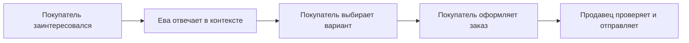

# Как Ева помогает продажам

Ева закрывает информационную часть продажи: читает вопрос, находит сведения, отвечает, помогает сравнить варианты и связывает согласованный выбор с заказом. Это работа между интересом покупателя и действиями продавца.

## Что уже наблюдается

| Работа Евы | Польза для процесса | Подтверждение |
| --- | --- | --- |
| Ответы в переписке | Часть вопросов не требует ручного набора ответа | 840 подтверждённых текстовых ответов в 546 диалогах |
| Ночные ответы | Покупатель может получить информацию после рабочего дня продавца | 121 ответ в 97 диалогах с 00:00 до 05:59 МСК |
| Отправка фото | Покупателю показывается конкретная вещь и её детали | 22 подтверждённых изображения в 5 диалогах |
| Размер и контекст заказа | Согласование остаётся рядом с товаром и заказом | Подтверждённый механизм, описан в разделе размеров |
| Проверки наличия и исхода отправки | Меньше оснований обещать недоступное или дублировать действие | Подтверждённые защитные механизмы |

Числа относятся к периоду **2–12 ноября 2026** с точными границами в [результатах](results.md). Наличие механизма не является измеренным процентом снижения ошибок.

## Насколько она подняла продажи?

**Подтверждённого процента прироста пока нет.** За наблюдаемый период магазин получил 266 заказов на 173 665 ₽, но эти заказы нельзя целиком приписать Еве.

На продажи одновременно влияют ассортимент, цены, продвижение, сезон, доступные остатки и работа владельца. Сравнить две суммы разных периодов и назвать разницу эффектом Евы было бы неправильно.

Корректная публичная формулировка:

> Ева уже отвечает покупателям, в том числе ночью, отправляет фото и помогает вести согласованный выбор. За измеренный период подтверждены 840 ответов в 546 диалогах; в магазине за это время оформлено 266 заказов. Вклад Евы в прирост выручки отдельно не измерен.

## Как получить доказательный ответ о росте

1. Заранее определить показатель: оплаченные заказы, завершённые продажи, поступления или прибыль.
2. Сравнивать сопоставимые периоды либо группы с похожими товарами и условиями.
3. Учесть цены, рекламу, доступность товара, сезон и изменения ассортимента.
4. Связать обращение с доставленным ответом и последующим заказом; отдельно отметить участие человека.
5. Дождаться исходов отмен и возвратов, затем публиковать размер выборки и неопределённость результата.

Это метод будущего измерения, а не описание уже проведённого эксперимента. Даже связь «ответ перед заказом» доказывает последовательность событий, но сама по себе не доказывает причину покупки.

---

[← Назад: товар и деньги](business-statistics.md) · [Содержание](README.md) · [Далее: как развивалась Ева →](eva-development.md)
