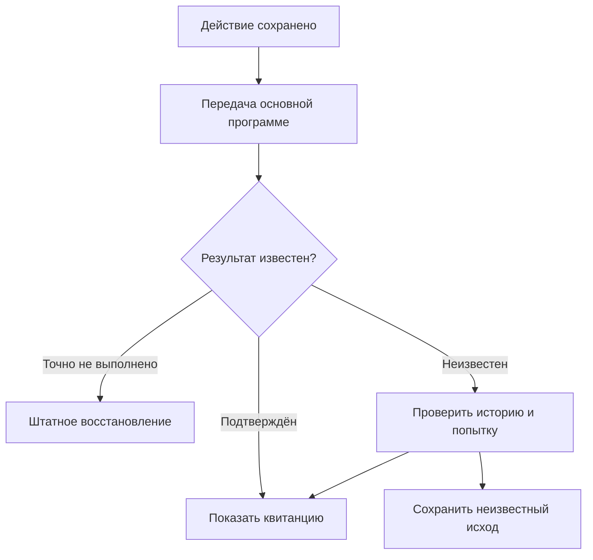

# Telegram как рабочий пульт

Telegram используется не только для уведомлений. Через него продавец принимает товар, находит вещь, видит связанные сведения и работает с доступными действиями заказа. Основная программа хранит общий контекст магазина.

## Что можно увидеть

| Раздел | Содержание |
| --- | --- |
| Поставки и приёмка | Продолжение партии, новый товар, фотографии, описание, размеры, количество и хранение |
| Поиск по складу | Основное фото, название, код, остаток и описание места |
| Вся информация о товаре | Сведения, варианты, цены, фотографии, хранение и предупреждения карточки |
| Заказы | Товар, выбранный размер, количество, статус, сборка, доставка, сроки и доступные действия |
| Документы отправки | Этикетка или код, относящиеся к конкретному заказу |

Права и доступность действия проверяются программой. Наличие кнопки или уведомления не отменяет ограничения владельца, Стоп или неизвестный исход предыдущей операции.

## Как устроены заказы

Список разбит по смыслу: в работе, требуют подтверждения, к отправке, в пути/получены, возвраты/споры, завершённые и все. Фильтр сохраняется при переходе между страницами.

На короткой кнопке важнее вещь и размер; подробная карточка содержит полный контекст заказа. Привязка действия идёт к устойчивой записи, а не к совпавшему названию товара.

> [!IMPORTANT]
> Этикетка отправлена на принтер — ещё не подтверждение сборки. «Заказ собран, этикетка наклеена» — отдельное действие продавца. Получение документа не означает, что вещь положили в посылку или передали перевозчику.

## Если связь пропала

Повторная доставка уже сохранённых сведений и повтор реального внешнего действия — разные ситуации. Карточку приёмки можно безопасно довезти по её идентичности и версии. Неизвестную печать, отправку покупателю или ценовое действие нельзя просто повторять новым нажатием в фоне.

## Уведомления и тихая приёмка

В системе предусмотрено откладывание уведомлений владельцу на время активной приёмки, чтобы не смешивать рабочий поток с фоновыми сигналами. Это не отключает учёт покупателей и не разрешает потерять открытый вопрос.

Telegram не подменяет физический склад: продавец по-прежнему проверяет вещь, подтверждает сборку и принимает возврат руками.

---

[← Назад: приёмка](telegram-intake.md) · [Содержание](README.md) · [Далее: склад и возвраты →](warehouse-and-returns.md)
