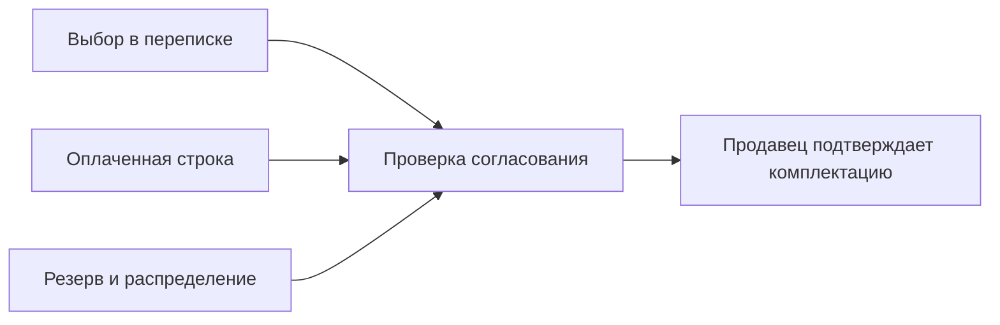

# Склад, размеры, заказы и возвраты

Свободный остаток — это то, что ещё можно предложить новому покупателю. Это не просто число когда-то принятых вещей.

## Что уменьшает доступность

| Состояние | Что происходит с товаром |
| --- | --- |
| Новый учтённый заказ | Занимает соответствующее количество |
| Заказ без согласованного размера или со Стоп | Продолжает занимать товар; Стоп не делает его свободным |
| Согласованный резерв | Удерживает точный товар на разрешённых условиях |
| Отмена до фактической отправки | Освобождает вещь, которая осталась у продавца |
| Отправленный заказ возвращается | Не доступен для новой продажи до личной приёмки и проверки |
| Владелец лично принял возврат | Доступность меняется только по подтверждённому результату приёмки |
| Неизвестный остаток | Требует уточнения, не превращается автоматически в ноль или положительное число |

## Общий товар и обувь

Для обычного товара актуальные обязательства расходуют общий физический пул, в том числе когда покупатель ещё не подтвердил размер или указал устаревший вариант.

**Учебный пример:** было 5 вещей, 3 заказа с размером и 2 без размера. Для нового заказа свободно 0, а не 2. Пометка Стоп у двух заказов не добавляет две вещи обратно.

У обуви сохраняются независимые количества точных размерных объявлений: свободный 43 не разрешает продажу отсутствующего 41.

## Четыре разных факта заказа

Выбор покупателя, оплаченная строка, учётное распределение и то, что действительно положено в посылку, различаются. Выбор владельцем размера не увеличивает физический остаток. Для найденных дополнительных единиц нужно отдельное подтверждение реального товара.

## Полка, ячейка и постоянный артикул

У вещи может быть несколько мест хранения, в том числе один размер в разных местах. Фотографии и описание относятся к конкретному месту.

Постоянный артикул сохраняет историю вещи. Номер освободившейся физической ячейки можно использовать снова после подтверждения, что она действительно пуста; постоянный артикул другой вещи переиспользовать нельзя.

Архив карточки в программе и снятие объявления на Авито — отдельные действия. Нулевой остаток не является разрешением самовольно снять, активировать или заново опубликовать объявление.

## Как обнаруживаются расхождения

Ежедневная сверка сравнивает доступность в программе с конечным остатком площадки и сохраняет границы проверки. Для двух инициаторов используется общий дневной слот, чтобы не запускать параллельные полные обходы.

Список нулевых действующих объявлений нужен владельцу для решения. Неизвестные Quantity и снятые объявления не должны выдаваться за подтверждённые действующие нули.

Эти правила объясняют устройство учёта. Они не обещают отсутствие исторических расхождений и не заменяют физическую инвентаризацию.

---

[← Назад: Telegram](telegram-workspace.md) · [Содержание](README.md) · [Далее: заказы →](orders.md)
